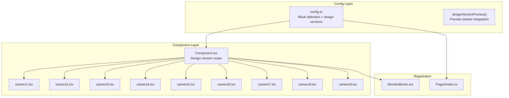

# Careers Block Implementation Plan

## Architecture Overview



## Shared Admin Panel Fields (Based on Component Analysis)

After analyzing all 9 careers components, these are the common data structures:

**Block-Level Fields (all variants):**

- `backgroundColor` - Theme color selection
- `designVersion` - With preview drawer (CAREERS1-CAREERS9)
- `heading` - Section title (e.g., "Careers", "Open Positions")
- `description` - Rich text description below heading
- `fallbackText` - "Don't see a role?" type message (conditional)

**Departments Array (for categorized designs: CAREERS1, CAREERS3, CAREERS4, CAREERS7, CAREERS8):**

- `name` - Department/category name
- `jobs` - Nested array of job listings

**Jobs Array (for flat designs: CAREERS2, CAREERS5, CAREERS6, CAREERS9):**

- Direct job listings without department grouping

**Job Fields (shared across both patterns):**

- `title` - Job title (required)
- `location` - Location text
- `type` - Employment type (Full-time, Part-time, Contract, Remote) - conditional
- `description` - Job description (textarea) - conditional
- `salary` - Salary range - conditional
- `experience` - Experience requirement - conditional
- `department` - Department badge (for flat list variants that show badges) - conditional
- `link` - Link field for "Apply" or job detail page

## Files to Create/Modify

### 1. Create Block Config

[`src/blocks/Careers/config.ts`](src/blocks/Careers/config.ts)

```typescript
// Key structure:
export const allCareersDesignVersions = [
  { label: 'CAREERS1', value: 'CAREERS1', image: '/admin/previews/careers/careers1.webp' },
  { label: 'CAREERS2', value: 'CAREERS2', image: '/admin/previews/careers/careers2.webp' },
  // ... CAREERS3-CAREERS9
] as const

export const CareersBlock: Block = {
  slug: 'careers',
  interfaceName: 'CareersBlock',
  fields: [
    backgroundColor,
    designVersionPreview(allCareersDesignVersions),
    // heading, description, departments/jobs arrays with conditional visibility
  ],
}
```

### 2. Create Main Component Router

[`src/blocks/Careers/Component.tsx`](src/blocks/Careers/Component.tsx)

Pattern follows [`src/blocks/Team/Component.tsx`](src/blocks/Team/Component.tsx):

- Import all 9 variant components
- Map design versions to components
- Return the appropriate variant based on `designVersion` prop

### 3. Copy and Adapt Variant Components

Copy from payblocks [`src/components/careers*.tsx`](payblocks/src/components/careers1.tsx) to payblocks [`src/blocks/Careers/`](src/blocks/Careers/):

- `careers1.tsx` - `careers9.tsx`
- Update imports to use `@/` paths
- Add `CareersBlock` type from `@/payload-types`
- Add `publicContext` prop pattern
- Map hardcoded data to props from Payload

### 4. Register Block

**[`src/collections/Pages/index.ts`](src/collections/Pages/index.ts):**

- Import `CareersBlock` from config
- Add to blocks array in layout field

**[`src/blocks/RenderBlocks.tsx`](src/blocks/RenderBlocks.tsx):**

- Import `CareersBlock` component
- Add `careers: CareersBlock` to blockComponents map

### 5. Preview Images

Preview images already exist at [`public/admin/previews/careers/`](public/admin/previews/careers/) (careers1.webp - careers9.webp). No action needed.

## Conditional Field Logic

Based on component analysis, conditional visibility will be applied as follows:

| Field | Visible For |

|-------|-------------|

| `departments` array | CAREERS1, CAREERS3, CAREERS4, CAREERS7, CAREERS8 |

| `jobs` array (flat) | CAREERS2, CAREERS5, CAREERS6, CAREERS9 |

| Job `type` field | CAREERS2, CAREERS5, CAREERS6 |

| Job `description` | CAREERS3, CAREERS5, CAREERS6 |

| Job `salary` | CAREERS5, CAREERS6 |

| Job `experience` | CAREERS6 |

| Job `department` badge | CAREERS5, CAREERS6, CAREERS9 |

| `fallbackText` | CAREERS2, CAREERS9 |

## Implementation Order

1. Create `config.ts` with design versions and field definitions
2. Create `Component.tsx` router
3. Copy and adapt all 9 variant files
4. Register in Pages collection and RenderBlocks
5. Generate types with `pnpm generate:types`
6. Test in admin panel
