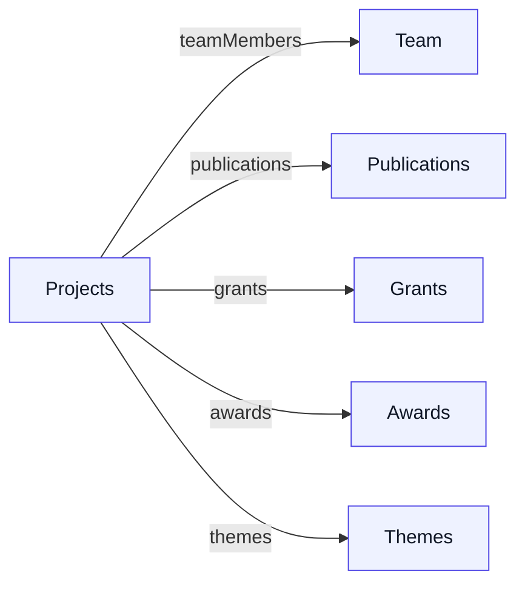
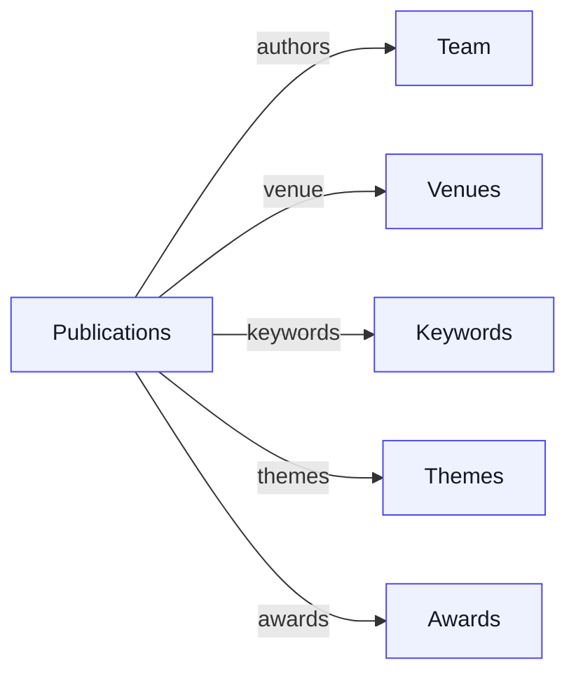
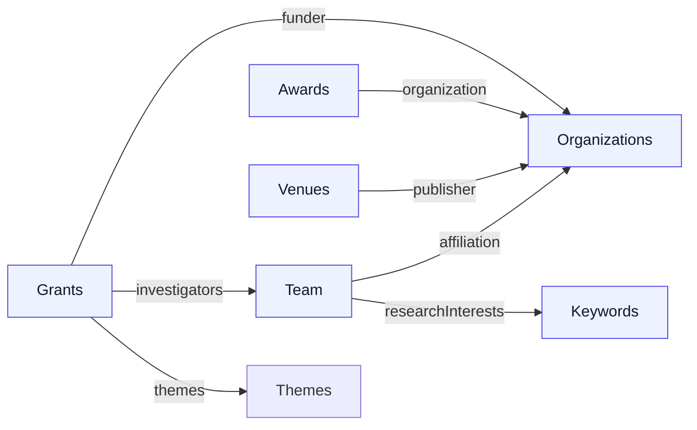
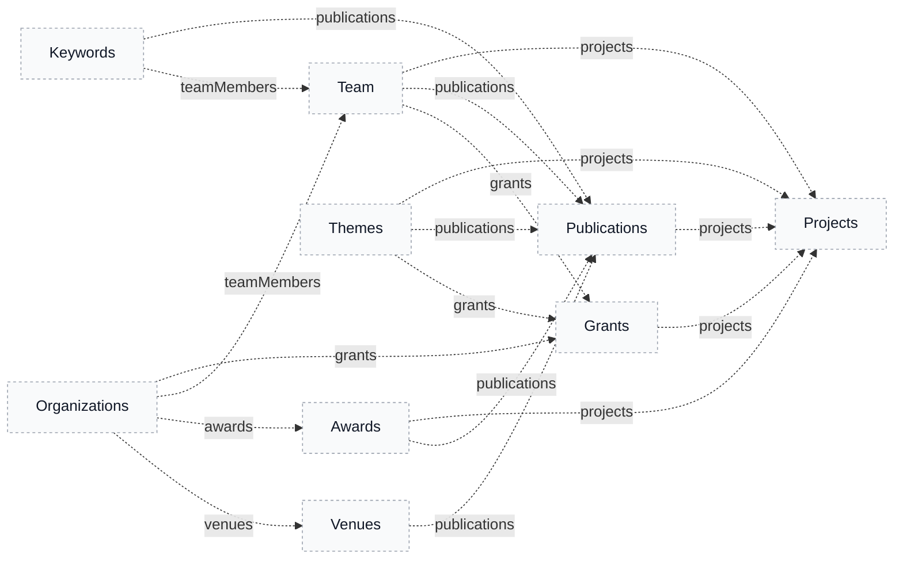

# DIAL Lab Data Schema & Relationships

> **Last Updated:** November 27, 2025

This document describes the data architecture for the DIAL (Design and Inclusion Access Lab) website at North South University. The schema is designed for:

1. **Schema.org compatibility** - JSON-LD structured data for SEO and academic discoverability
2. **OpenAlex compatibility** - Future integration with the OpenAlex academic graph
3. **Admin UX** - Filing cabinet philosophy where entities own their relationships
4. **Academic credibility** - Proper citation tracking, author disambiguation, and funding attribution

---

## Table of Contents

- [Filing Cabinet Philosophy](#filing-cabinet-philosophy)
- [Collection Overview](#collection-overview)
- [Relationship Map](#relationship-map)
- [Detailed Schemas](#detailed-schemas)
  - [Projects](#projects)
  - [Publications](#publications)
  - [Team](#team)
  - [Grants](#grants)
  - [Awards](#awards)
  - [Research Themes](#research-themes)
  - [Keywords](#keywords)
  - [Venues](#venues)
  - [Organizations](#organizations)
  - [Lab Info (Global)](#lab-info-global)
- [Schema.org Mappings](#schemaorg-mappings)
- [OpenAlex Mappings](#openalex-mappings)

---

## Filing Cabinet Philosophy

The relationship architecture follows a **filing cabinet model** where:

- **Relationships** (editable) = The collection that conceptually "owns" the data defines the link
- **Joins** (read-only) = Reverse lookups that show related items without data duplication

### Why This Matters

In academia, a **Project** owns its team members, publications, and funding sources. You don't go to a person's profile to add them to a project—you go to the project and add the person. This reflects how research labs actually operate:

- Principal Investigators manage project teams
- Publications are outputs of funded projects
- Awards are given to specific papers or projects
- Grants fund specific research initiatives

---

## Collection Overview

| Collection | Purpose | Schema.org Type | OpenAlex Type |
|------------|---------|-----------------|---------------|
| **Projects** | Research projects and case studies | `ResearchProject` | — |
| **Publications** | Academic papers, articles, chapters | `ScholarlyArticle` | `Work` |
| **Team** | Lab members, collaborators, alumni | `Person` | `Author` |
| **Grants** | Research funding | `Grant` / `MonetaryGrant` | `Funder` (relationship) |
| **Awards** | Recognition (Best Paper, etc.) | `Award` (property) | — |
| **Research Themes** | Research areas/topics | `Thing` (with `about`) | — |
| **Keywords** | Reusable concepts/tags | `DefinedTerm` | `Concept` |
| **Venues** | Conferences, journals | `Periodical` / `Event` | `Source` |
| **Organizations** | Institutions, funders, publishers | `Organization` subtypes | `Institution` |
| **Lab Info** | Global lab configuration | `ResearchOrganization` | `Institution` |

---

## Relationship Map

**Ownership: Projects as the hub**



**Ownership: Publication-centric**



**Ownership: Grants, Team, and Organizations**



**Joins: What you see on each collection from others**



Legend: The **ownership diagrams** show where relationships are edited in the admin; the **joins diagram** shows which collections expose reverse lookups for convenience.

### Ownership Summary

| Collection | Owns (Editable Relationships) | Shows (Read-only Joins) |
|------------|-------------------------------|-------------------------|
| **Projects** | teamMembers, publications, grants, awards, themes | — |
| **Publications** | authors, venue, keywords, themes, awards | projects |
| **Grants** | funder, investigators, themes | projects |
| **Team** | affiliation, researchInterests | projects, publications, grants |
| **Awards** | organization | projects, publications |
| **Research Themes** | icon | projects, publications, grants |
| **Keywords** | — | publications, teamMembers |
| **Venues** | publisher | publications |
| **Organizations** | — | grants, teamMembers, awards, venues |

---

## Detailed Schemas

### Projects

The central hub for research activities. A project contains team members, produces publications, receives funding, and may win awards.

```typescript
{
  // Core
  title: string              // Required
  slug: string               // Auto-generated
  abstract: string           // Brief description for cards
  heroImage: Media           // Featured image
  externalUrl: string        // Project URL
  
  // Timeline
  startDate: Date
  endDate: Date              // Only for completed projects
  status: 'ongoing' | 'completed'
  
  // Relationships (owned)
  teamMembers: Team[]        // Lab members on this project
  grants: Grant[]            // Funding sources
  themes: ResearchTheme[]    // Research areas
  publications: Publication[] // Papers from this project
  awards: Award[]            // Recognition received
  
  // Content
  content: RichText          // Detailed write-up
  appendLayoutBlock: Block[] // Additional blocks (StatBlock, AwardsBlock)
  
  // Case Study Fields (conditional on designVersion)
  projectLayoutSettings: {
    overview: string         // Abstract Override
    metaItems: [{ label, value }] // Sidebar Metadata
    problem: string          // Problem Statement
    approach: string         // Approach Description
    outcomes: [{ headline }] // Impact statements
    shareLabel: string       // Share label
  }
  
  // Meta
  featured: boolean          // Show on homepage
  designVersion: string      // Layout variant
  pageAuthor: User[]         // Content author (internal)
}
```

**Schema.org mapping:** `ResearchProject`

---

### Publications

Academic papers, conference proceedings, journal articles, and other scholarly works.

```typescript
{
  // Core
  title: string              // Required
  abstract: string           // Critical for SEO
  year: number               // Required, indexed
  publicationDate: Date      // Exact date for sorting
  
  // Authors (ordered array)
  authors: [{
    teamMember?: Team        // Link to team member
    customAuthor?: string    // External collaborator name
    authorPosition: number   // Auto-populated order
    isCoFirst: boolean       // Equal contribution marker
    isCorresponding: boolean // Contact author
  }]
  
  // Classification
  type: 'conference' | 'journal' | 'workshop' | 'preprint' | 
        'extended-abstract' | 'study-protocol' | 'book-chapter'
  status: 'published' | 'accepted-in-press' | 'submitted' | 'preprint'
  
  // Venue
  venue: Venue               // Relationship to Venues collection
  venueLabel: string         // Display name (e.g., "CHI '24")
  location: string           // Conference location
  
  // Citation details
  volume: string
  issue: string
  pageStart: string
  pageEnd: string
  citationText: string       // Full citation string
  
  // Identifiers & Links
  doi: string                // Validated format: 10.xxxx/xxxxx
  externalUrl: string        // Publisher URL
  pdf: { type, upload, link }
  
  // Access
  isOpenAccess: boolean      // For schema.org isAccessibleForFree
  license: 'all-rights-reserved' | 'cc-by' | 'cc-by-sa' | 'cc-by-nc' | 
           'cc-by-nc-sa' | 'cc-by-nd' | 'cc-by-nc-nd' | 'cc0'
  
  // Relationships (owned)
  keywords: Keyword[]
  themes: ResearchTheme[]
  awards: Award[]
  
  // Joins (read-only)
  projects: Project[]        // Via Projects.publications
  
  // OpenAlex sync
  openalex_id: string        // Auto-populated
  citationCount: number      // Auto-populated
  citationCountUpdatedAt: Date
  
  // Meta
  featured: boolean
  bibtex: string             // For import
}
```

**Schema.org mapping:** `ScholarlyArticle`  
**OpenAlex mapping:** `Work`

---

### Team

Lab members, collaborators, and alumni. Supports structured name fields for proper citation formatting.

```typescript
{
  // Identity
  name: string               // Auto-generated from parts (hidden)
  firstName: string          // Required - for schema.org givenName
  middleName: string
  lastName: string           // Required - for schema.org familyName
  slug: string
  
  // Professional
  title: string              // Required (e.g., "PhD Candidate")
  role: 'director' | 'faculty' | 'graduate-ra' | 'undergraduate-ra' | 
        'alumni' | 'interdisciplinary-collaborator' | 'external-collaborator'
  
  // Affiliation
  affiliation: Organization  // Primary institution
  affiliationLabel: string   // Override or custom text
  
  // Profile
  photo: Media
  bio: RichText
  researchInterests: Keyword[]
  
  // Contact & Links
  email: string
  socials: [{ platform, url }]  // Google Scholar, LinkedIn, GitHub, etc.
  
  // Academic Identifiers
  orcid: string              // ORCID iD
  openalex_author_id: string // For OpenAlex sync
  
  // Alumni tracking
  alumniYear: number         // Year of departure
  currentPosition: string    // "Software Engineer at Google"
  
  // Joins (read-only)
  projects: Project[]        // Via Projects.teamMembers
  publications: Publication[] // Via Publications.authors
  grants: Grant[]            // Via Grants.investigators
  
  // Meta
  displayInWebsite: boolean
}
```

**Schema.org mapping:** `Person`  
**OpenAlex mapping:** `Author`

---

### Grants

Research funding from agencies, foundations, or industry.

```typescript
{
  // Core
  title: string              // Required
  slug: string
  description: string
  
  // Funder
  funder: Organization       // Relationship
  funderLabel: string        // Auto-populated or override
  
  // Details
  grantNumber: string        // Official award number
  amountValue: number        // Min: 0
  amountCurrency: 'USD' | 'BDT' | 'EUR' | 'GBP'
  
  // Timeline
  startDate: Date
  endDate: Date
  status: 'active' | 'completed' | 'pending'
  
  // Investigators (ordered)
  investigators: [{
    teamMember: Team         // Required
    role: 'pi' | 'co-pi' | 'collaborator'
  }]
  
  // Relationships (owned)
  themes: ResearchTheme[]
  
  // Joins (read-only)
  projects: Project[]        // Via Projects.grants
  
  // Links
  url: string                // Grant announcement page
  
  // Meta
  featured: boolean
}
```

**Schema.org mapping:** `Grant` / `MonetaryGrant`

---

### Awards

Recognition for publications and projects (Best Paper, Honorable Mention, etc.).

```typescript
{
  // Core
  title: string              // Required (e.g., "Best Paper Award")
  year: number               // Required, indexed
  
  // Category
  category: 'best-paper' | 'honorable-mention' | 'best-presentation' | 
            'best-demo' | 'best-poster' | 'other'
  
  // Granting Organization
  organization: Organization
  organizationLabel: string  // Auto-populated or override (e.g., "ACM CHI")
  
  // Links
  url: string                // Award announcement
  
  // Joins (read-only)
  projects: Project[]        // Via Projects.awards
  publications: Publication[] // Via Publications.awards
}
```

**Schema.org mapping:** Used as `award` property on `CreativeWork`

---

### Research Themes

High-level research areas that group projects, publications, and grants.

```typescript
{
  // Core
  title: string              // Required
  slug: string
  shortDescription: string   // For landing page cards
  
  // Visual
  icon: Media
  featured: boolean          // Highlight on homepage
  
  // Joins (read-only)
  projects: Project[]        // Via Projects.themes
  publications: Publication[] // Via Publications.themes
  grants: Grant[]            // Via Grants.themes
}
```

---

### Keywords

Reusable concepts and tags for publications and team research interests.

```typescript
{
  // Core
  title: string              // Required, localized
  slug: string
  
  // OpenAlex
  openAlexId: string         // Concept identifier
  
  // Joins (read-only)
  publications: Publication[] // Via Publications.keywords
  teamMembers: Team[]        // Via Team.researchInterests
}
```

**Schema.org mapping:** `DefinedTerm`  
**OpenAlex mapping:** `Concept`

---

### Venues

Publication venues: conferences, journals, workshops.

```typescript
{
  // Core
  name: string               // Required (full name)
  shortName: string          // Abbreviation (e.g., "CHI", "TOCHI")
  
  // Classification
  type: 'conference' | 'journal' | 'workshop' | 'book-series' | 'other'
  
  // Identifiers
  url: string
  issn: string               // For journals
  wikidata_id: string        // For disambiguation
  openalex_id: string        // Source identifier
  
  // Publisher
  publisher: Organization    // e.g., ACM, IEEE, Springer
  
  // Joins (read-only)
  publications: Publication[] // Via Publications.venue
}
```

**Schema.org mapping:** `Periodical` (journals) / `Event` (conferences)  
**OpenAlex mapping:** `Source`

---

### Organizations

Lookup table for institutions, funders, publishers.

```typescript
{
  // Core
  name: string               // Required (full name)
  shortName: string          // Abbreviation (e.g., "NSF", "ACM")
  
  // Classification
  type: 'university' | 'research-institute' | 'funding-agency' | 
        'company' | 'government' | 'publisher' | 'other'
  
  // Identifiers
  url: string
  ror_id: string             // Research Organization Registry
  openalex_id: string        // Institution identifier
  
  // Joins (read-only)
  grants: Grant[]            // Via Grants.funder
  teamMembers: Team[]        // Via Team.affiliation
  awards: Award[]            // Via Awards.organization
  venues: Venue[]            // Via Venues.publisher
}
```

**Schema.org mapping:** `Organization`, `ResearchOrganization`, `EducationalOrganization`, `FundingAgency`  
**OpenAlex mapping:** `Institution`

---

### Lab Info (Global)

Global configuration for the lab itself. Provides the root organization context for all JSON-LD output.

```typescript
{
  // Identity
  name: string               // "DIAL Lab"
  shortName: string          // "DIAL"
  description: string        // For SEO
  
  // Parent Institution
  parentOrganization: {
    name: string             // "North South University"
    url: string
    department: string       // "Department of ECE"
  }
  
  // Contact
  email: string
  url: string                // Canonical lab URL
  logo: Media
  
  // Location
  location: {
    address: string
    city: string             // "Dhaka"
    country: string          // "Bangladesh"
  }
  
  // Social/External
  socials: [{ platform, url }]  // For schema.org sameAs
  
  // Identifiers
  identifiers: {
    ror_id: string
    wikidata_id: string
    openalex_id: string
  }
  
  // History
  foundingDate: Date
}
```

**Schema.org mapping:** `ResearchOrganization`

---

## Schema.org Mappings

### Publication → ScholarlyArticle

```json
{
  "@context": "https://schema.org",
  "@type": "ScholarlyArticle",
  "headline": "{{ title }}",
  "abstract": "{{ abstract }}",
  "datePublished": "{{ publicationDate }}",
  "author": [
    {
      "@type": "Person",
      "givenName": "{{ author.firstName }}",
      "familyName": "{{ author.lastName }}",
      "affiliation": {
        "@type": "Organization",
        "name": "{{ author.affiliation.name }}"
      }
    }
  ],
  "isPartOf": {
    "@type": "Periodical",
    "name": "{{ venue.name }}",
    "issn": "{{ venue.issn }}"
  },
  "publisher": {
    "@type": "Organization",
    "name": "{{ venue.publisher.name }}"
  },
  "identifier": {
    "@type": "PropertyValue",
    "propertyID": "DOI",
    "value": "{{ doi }}"
  },
  "isAccessibleForFree": "{{ isOpenAccess }}",
  "license": "{{ license }}"
}
```

### Team Member → Person

```json
{
  "@context": "https://schema.org",
  "@type": "Person",
  "@id": "{{ siteUrl }}/team/{{ slug }}",
  "givenName": "{{ firstName }}",
  "familyName": "{{ lastName }}",
  "jobTitle": "{{ title }}",
  "email": "{{ email }}",
  "affiliation": {
    "@type": "Organization",
    "name": "{{ affiliation.name }}"
  },
  "sameAs": [
    "https://orcid.org/{{ orcid }}",
    "{{ socials[platform=google-scholar].url }}"
  ]
}
```

### Lab → ResearchOrganization

```json
{
  "@context": "https://schema.org",
  "@type": "ResearchOrganization",
  "name": "{{ labInfo.name }}",
  "alternateName": "{{ labInfo.shortName }}",
  "description": "{{ labInfo.description }}",
  "url": "{{ labInfo.url }}",
  "logo": "{{ labInfo.logo.url }}",
  "parentOrganization": {
    "@type": "EducationalOrganization",
    "name": "{{ labInfo.parentOrganization.name }}",
    "department": {
      "@type": "Organization",
      "name": "{{ labInfo.parentOrganization.department }}"
    }
  },
  "address": {
    "@type": "PostalAddress",
    "addressLocality": "{{ labInfo.location.city }}",
    "addressCountry": "{{ labInfo.location.country }}"
  },
  "foundingDate": "{{ labInfo.foundingDate }}",
  "sameAs": ["{{ labInfo.socials[].url }}"]
}
```

---

## OpenAlex Mappings

For future n8n integration, these fields map to OpenAlex entities:

| Collection | OpenAlex Entity | Key Fields |
|------------|-----------------|------------|
| Publications | Work | `openalex_id`, `doi`, `citationCount` |
| Team | Author | `openalex_author_id`, `orcid` |
| Keywords | Concept | `openAlexId` |
| Venues | Source | `openalex_id`, `issn` |
| Organizations | Institution | `openalex_id`, `ror_id` |
| Lab Info | Institution | `identifiers.openalex_id` |

### Sync Strategy (Future)

1. **Publications**: Match by DOI → update `openalex_id`, `citationCount`
2. **Team**: Match by ORCID or name → update `openalex_author_id`
3. **Venues**: Match by ISSN or name → update `openalex_id`
4. **Organizations**: Match by ROR ID or name → update `openalex_id`

---

## Data Integrity Features

### Validation Hooks

- **DOI format**: Regex validation `^10\.\d{4,9}/[-._;()/:A-Z0-9]+$`
- **Grant amount**: Min value of 0
- **Author array**: Requires either teamMember or customAuthor per entry
- **Duplicate detection**: Warns on potential duplicate Organizations/Venues

### Auto-Population Hooks

- **Team.name**: Generated from firstName + middleName + lastName
- **Publications.venueLabel**: Auto-filled from Venue.shortName
- **Grants.funderLabel**: Auto-filled from Organization.shortName
- **Awards.organizationLabel**: Auto-filled from Organization.shortName
- **Publications.authorPosition**: Auto-numbered based on array order

---

## Admin UX Conventions

### Tab Organization

Complex collections use tabs to reduce cognitive load:

- **Publications**: Content → Publication Info → Links & Files
- **Projects**: Overview → Team & Funding → Outputs → Content → SEO
- **Team**: Profile → Contact & Identifiers

### Sidebar Fields

Quick-access fields in the sidebar:

- Status/visibility toggles (featured, displayInWebsite)
- Classification selects (role, status, type)
- Join fields (read-only related items)

### Conditional Fields

Fields that only appear when relevant:

- `endDate` only for completed projects
- `alumniYear` and `currentPosition` only for alumni
- `location` only for conference/workshop publications
- `acceptanceDate` only for accepted-in-press publications
