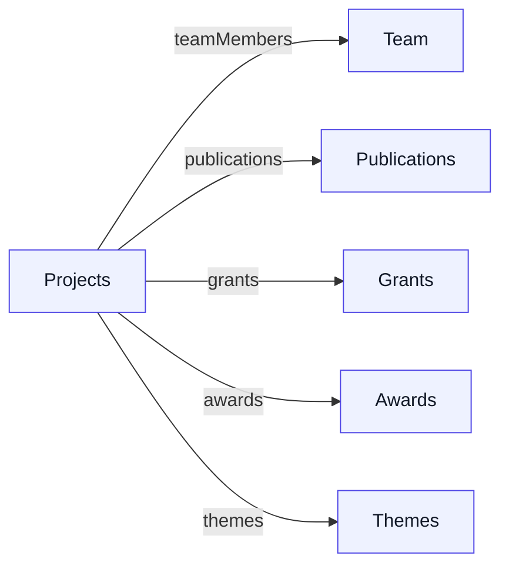
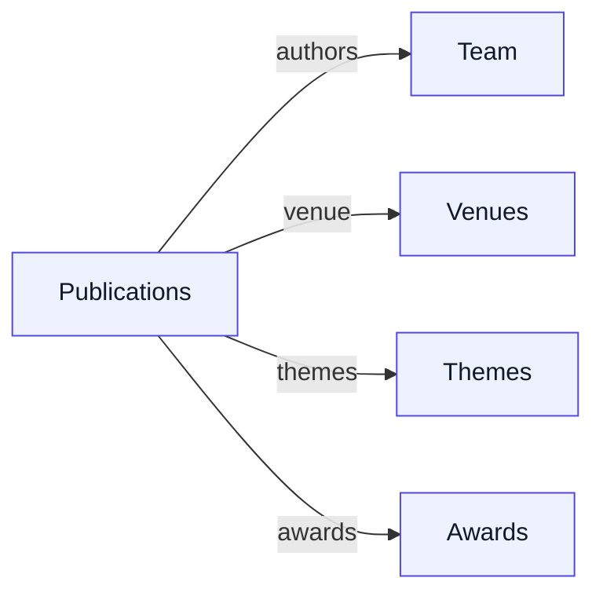
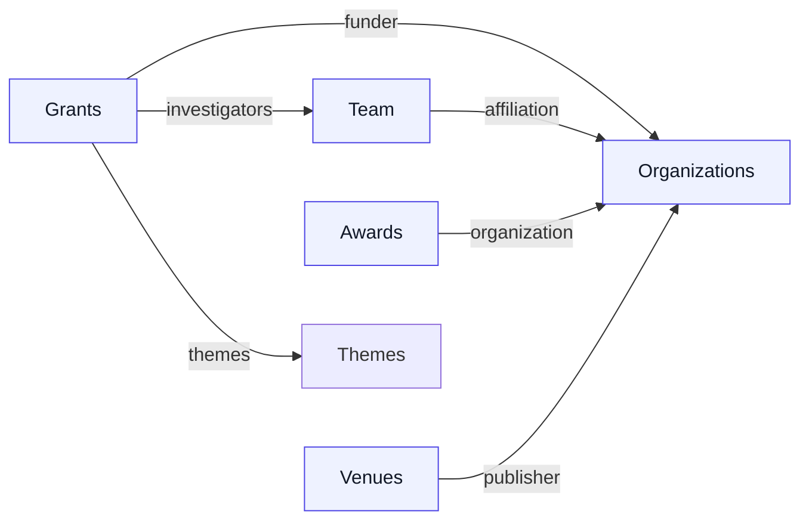
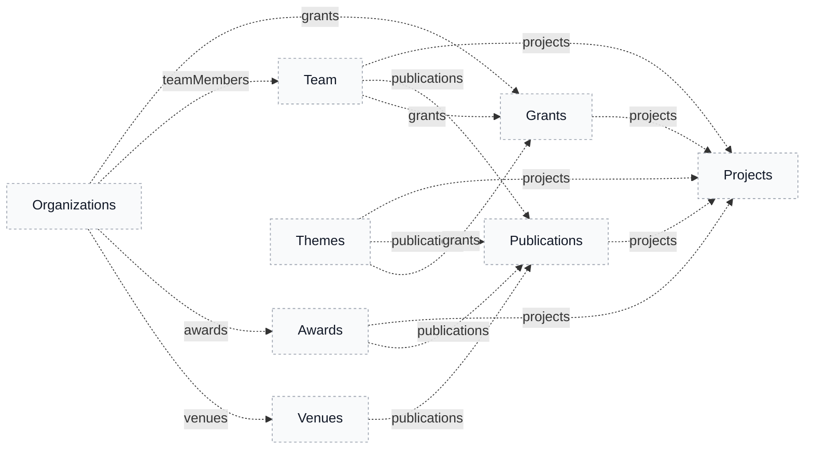

# Research Collections: Ownership & Relationships

This document explains the relationship architecture across LabKit's research collections (Projects, Publications, Team, Grants, Awards, Research Themes, Venues, Organizations) — specifically, which collection owns each relationship and which side just shows a read-only reverse lookup.

For field-level schema (what fields exist on each collection), read the collection config in `src/collections/` directly — that's the source of truth and this doc won't try to duplicate it.

---

## Filing Cabinet Philosophy

The relationship architecture follows a **filing cabinet model** where:

- **Relationships** (editable) = The collection that conceptually "owns" the data defines the link
- **Joins** (read-only) = Reverse lookups that show related items without data duplication

### Why This Matters

In academia, a **Project** owns its team members, publications, and funding sources. You don't go to a person's profile to add them to a project—you go to the project and add the person. This reflects how research labs actually operate:

- Principal Investigators manage project teams
- Publications are outputs of funded projects
- Awards are given to specific papers or projects
- Grants fund specific research initiatives

---

## Collection Overview

| Collection | Purpose | Schema.org Type | OpenAlex Type |
|------------|---------|-----------------|---------------|
| **Projects** | Research projects and case studies | `ResearchProject` | — |
| **Publications** | Academic papers, articles, chapters | `ScholarlyArticle` | `Work` |
| **Team** | Lab members, collaborators, alumni | `Person` | `Author` |
| **Grants** | Research funding | `Grant` / `MonetaryGrant` | `Funder` (relationship) |
| **Awards** | Recognition (Best Paper, etc.) | `Award` (property) | — |
| **Research Themes** | Research areas/topics | `Thing` (with `about`) | — |
| **Venues** | Conferences, journals | `Periodical` / `Event` | `Source` |
| **Organizations** | Institutions, funders, publishers | `Organization` subtypes | `Institution` |
| **Lab Info** | Global lab configuration | `ResearchOrganization` | `Institution` |

---

## Relationship Map

**Ownership: Projects as the hub**

**Ownership: Publication-centric**

`keywords` is a free-text tag array on Publications (`type: 'text', hasMany: true`), not a relationship to another collection.

**Ownership: Grants, Team, and Organizations**

`researchInterests` is a free-text array on Team (`type: 'text', hasMany: true`), not a relationship.

**Joins: What you see on each collection from others**

Legend: The **ownership diagrams** show where relationships are edited in the admin; the **joins diagram** shows which collections expose reverse lookups for convenience.

### Ownership Summary

| Collection | Owns (Editable Relationships) | Shows (Read-only Joins) |
|------------|-------------------------------|-------------------------|
| **Projects** | teamMembers, publications, grants, awards, themes | — |
| **Publications** | authors, venue, themes, awards | projects |
| **Grants** | funder, investigators, themes | projects |
| **Team** | affiliation | projects, publications, grants |
| **Awards** | organization | projects, publications |
| **Research Themes** | icon | projects, publications, grants |
| **Venues** | publisher | publications |
| **Organizations** | — | grants, teamMembers, awards, venues |

