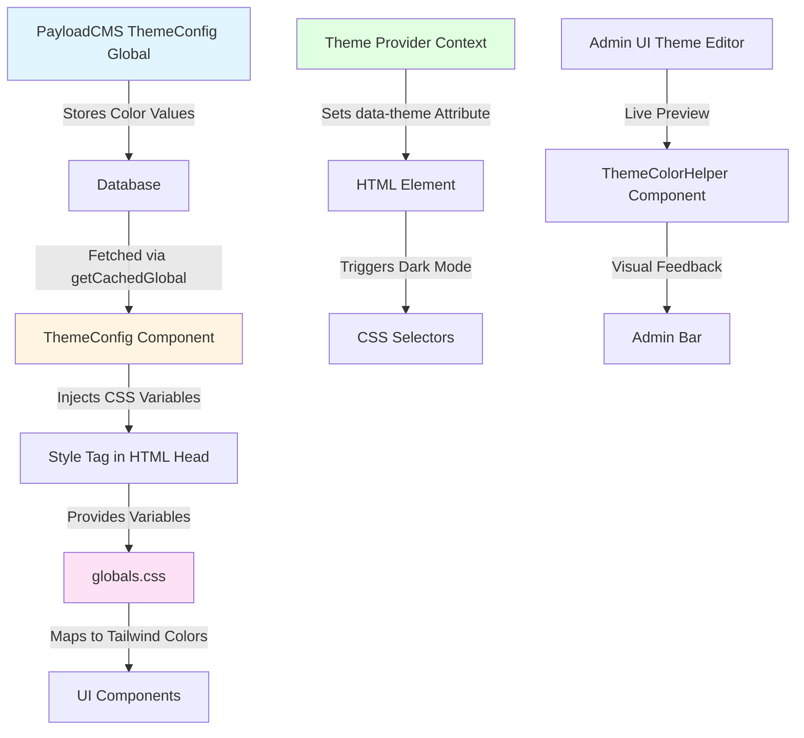
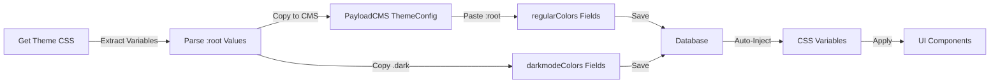
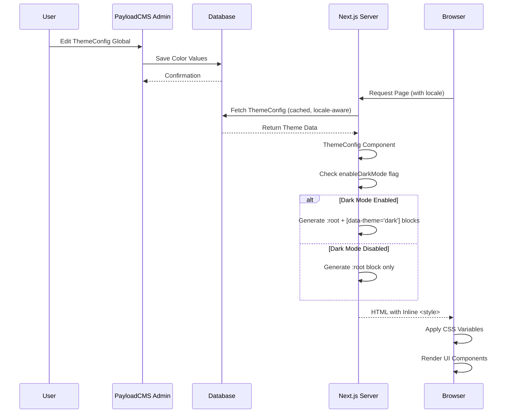

# Theming System Architecture

**Last Updated:** January 2025  
**Status:** Stable - Documentation updated to reflect current implementation (localization support, ring-3 mapping, dark mode limitations, ThemeSelector auto mode)  
**Previous Status:** Minor update: Sidebar variables added (see [shadcn-sidebar-variables-update.md](../reports/shadcn-breaking-updates/shadcn-sidebar-variables-update.md))

## Executive Summary

The LabKit theming system is a CMS-driven architecture that extends the standard shadcn/ui theme variables with PayloadCMS integration. It maintains full compatibility with all shadcn-compatible theme providers (Shadcn Official, TweakCN, StyleGlide, JLN UI) while adding database persistence and admin UI management capabilities.

**Key Characteristics:**

- ✅ **100% Compatible** with shadcn ecosystem themes
- ✅ **CMS-Driven** - Colors stored in PayloadCMS database
- ✅ **Dual Dark Mode Support** - Works with both `.dark` class and `[data-theme='dark']` attribute
- ✅ **Zero Breaking Changes** - Unchanged since initial template commit
- ✅ **Real-time Preview** - Built-in Theme Editor tool for live adjustments

---

## System Architecture

The theming system uses a three-layer architecture:



**Flow:**

1. **CMS Layer:** Theme colors are stored in PayloadCMS `themeConfig` global collection
2. **Server Layer:** `ThemeConfig` component fetches values and injects CSS variables via `<style>` tag
3. **Client Layer:** React Context manages dark/light mode switching with `data-theme` attribute
4. **CSS Layer:** `globals.css` maps CMS variables to Tailwind utility classes

---

## File Structure

### Core Theme Configuration Files

```
src/
├── globals/
│   └── ThemeConfig/
│       ├── config.ts              # PayloadCMS global schema definition
│       ├── Component.tsx          # Server component that injects CSS variables
│       └── hooks/
│           └── revalidateThemeConfig.ts  # ISR revalidation hook
│
├── providers/
│   ├── Theme/
│   │   ├── index.tsx              # Main Theme Provider (React Context)
│   │   ├── types.ts               # TypeScript type definitions (Theme, ThemeContextType)
│   │   ├── shared.ts              # Shared constants and utilities (getImplicitPreference)
│   │   ├── InitTheme/
│   │   │   └── index.tsx          # Client-side theme initialization script
│   │   └── ThemeSelector/
│   │       ├── index.tsx          # UI component for theme switching
│   │       └── types.ts           # Theme type, themeLocalStorageKey, defaultTheme
│   │
│   └── HeaderTheme/
│       └── index.tsx              # Separate theme context for header component
│
├── cssVariables.ts                # JavaScript constants (minimal usage)
│
└── app/
    └── (frontend)/
        └── [[...slugs]]/
            └── globals.css        # Tailwind CSS configuration + variable mapping
```

### Supporting Files

```
src/
├── components/
│   └── AdminBar/
│       └── ThemeColorHelper.tsx   # Visual theme editor tool for admin panel
│
└── utilities/
    └── getGlobals.ts              # Caching utility for global data fetching
```

---

## Component Breakdown

### 1. ThemeConfig Global (`src/globals/ThemeConfig/config.ts`)

**Purpose:** Defines the PayloadCMS schema for theme configuration.

**Key Features:**

- Two color groups: `regularColors` (light mode) and `darkmodeColors` (dark mode)
- Individual color fields for all shadcn theme variables
- Color validation (accepts hex, rgb, hsl, oklch formats)
- Default values for all colors
- Optional dark mode enable/disable toggle
- Border radius configuration

**Fields Include:**

- `background`, `foreground`
- `card`, `card-foreground`
- `popover`, `popover-foreground`
- `primary`, `primary-foreground`
- `secondary`, `secondary-foreground`
- `muted`, `muted-foreground`
- `accent`, `accent-foreground`
- `destructive`, `destructive-foreground`
- `border`, `input`, `ring-3` (mapped to CSS variable `--ring`)
- `success`, `warning`, `error`
- `chart-1` through `chart-5`
- `muted2`, `muted2-foreground`
- `radius` (border radius)

**Access:** `/admin/globals/themeConfig`

### 2. ThemeConfig Component (`src/globals/ThemeConfig/Component.tsx`)

**Purpose:** Server-side React component that injects CSS variables into the HTML head.

**Component Signature:**

```typescript
export async function ThemeConfig({ 
  publicContext 
}: { 
  publicContext: PublicContextProps 
})
```

**Key Parameters:**

- `publicContext`: Contains locale information for multi-locale theme support
  - `publicContext.locale`: Locale string (e.g., 'en', 'de') used to fetch locale-specific theme configuration

**How It Works:**

1. Fetches `themeConfig` global using `getCachedGlobal('themeConfig', publicContext.locale, 2)()` with locale support
2. Generates inline `<style>` tag with CSS variables
3. Maps CMS values to CSS custom properties
4. Conditionally includes dark mode variables only if `enableDarkMode` is true
5. Injects via `dangerouslySetInnerHTML`

**Important Notes:**

- **Ring Variable Mapping:** The config field `ring-3` is mapped to the CSS variable `--ring`:
  - Config: `regularColors['ring-3']` → CSS: `--ring`
  - This naming difference exists to match shadcn's CSS variable convention while maintaining valid field names in PayloadCMS

**Output Structure:**

```css
:root {
  --radius: 0.5rem;
  --background: #ffffff;
  --foreground: #0a0a0a;
  --ring: #0a0a0a;  /* mapped from ring-3 field */
  /* ... all light mode colors including chart-1 through chart-5, muted2, muted2-foreground ... */
}

/* Only rendered if enableDarkMode is true */
[data-theme='dark'] {
  --background: #0a0a0a;
  --foreground: #ffffff;
  --ring: #ffffff;  /* mapped from ring-3 field */
  /* Note: Dark mode block does NOT include chart-1 through chart-5, muted2, or muted2-foreground */
  /* Only includes: background, foreground, card, popover, primary, secondary, muted, accent, destructive, border, input, ring, success, warning, error */
}
```

**Location:** Rendered in root layout (`src/app/(frontend)/[[...slugs]]/layout.tsx`), injected into `<head>`

### 3. Theme Provider (`src/providers/Theme/index.tsx`)

**Purpose:** Client-side React Context for managing theme state and dark/light mode switching.

**Features:**

- Manages `data-theme` attribute on `<html>` element
- Stores user preference in `localStorage`
- Detects system preference via `prefers-color-scheme`
- Provides `useTheme()` hook for components
- Supports "auto" mode (follows system preference)

**Key Methods:**

- `setTheme(theme: 'light' | 'dark' | null)` - Sets explicit theme or clears to auto
- `theme` - Current theme state

**Storage Key:** `payload-theme` (in localStorage)

### 4. ThemeSelector Component (`src/providers/Theme/ThemeSelector/index.tsx`)

**Purpose:** UI component for theme switching in the application.

**Features:**

- Provides dropdown selector for theme switching
- Supports three modes: "auto", "light", "dark"
- "Auto" mode follows system preference (`prefers-color-scheme`)
- Stores user preference in localStorage

**Theme Modes:**

1. **Auto** (`null`): Follows system preference
   - Sets theme to `null` in context
   - Theme provider detects system preference via `prefers-color-scheme`
   - Automatically switches when system preference changes

2. **Light**: Forces light mode
   - Sets `data-theme="light"` on `<html>` element
   - Overrides system preference

3. **Dark**: Forces dark mode
   - Sets `data-theme="dark"` on `<html>` element
   - Overrides system preference

**Implementation:**

- Uses `useTheme()` hook from Theme Provider
- Setting theme to `null` enables auto mode
- Setting theme to `'light'` or `'dark'` forces explicit mode

### 5. InitTheme Component (`src/providers/Theme/InitTheme/index.tsx`)

**Purpose:** Prevents flash of unstyled content (FOUC) by setting theme before React hydrates.

**How It Works:**

- Renders a `<Script>` with `strategy="beforeInteractive"`
- Executes inline JavaScript before page load
- Reads localStorage preference (key: `payload-theme`)
- Falls back to system preference if no stored preference
- Sets `data-theme` attribute immediately

**Note:** Imports `defaultTheme` and `themeLocalStorageKey` from `ThemeSelector/types.ts` (not `shared.ts`)

**Critical For:** Preventing white flash on dark mode pages

### 6. globals.css (`src/app/(frontend)/[[...slugs]]/globals.css`)

**Purpose:** Tailwind CSS configuration and CSS variable to Tailwind color mapping.

**Key Sections:**

**1. Custom Dark Mode Variant:**

```css
@custom-variant dark (&:where(.dark, .dark *));
```

This enables dual support for both `.dark` class and `[data-theme='dark']` attribute.

**2. Theme Variable Mapping:**

```css
@theme inline {
  --color-background: var(--background);
  --color-foreground: var(--foreground);
  /* ... maps CMS variables to Tailwind colors ... */
}
```

**3. Base Styles:**

- Applies theme-aware base styles
- Sets default border colors
- Configures body background/foreground
- Includes FOUC prevention (opacity: 0 until theme loaded)

**4. FOUC Prevention:**

```css
html {
  opacity: 0;
}

html[data-theme='dark'],
html[data-theme='light'] {
  opacity: initial;
}
```

### 7. ThemeColorHelper (`src/components/AdminBar/ThemeColorHelper.tsx`)

**Purpose:** Visual debugging tool for theme development.

**Features:**

- Renders color pickers for each CSS variable
- Shows variable names on hover
- Highlights which variables are used by hovered elements
- Provides real-time preview of color changes
- Useful for testing theme compatibility

**Access:** Enable "Theme Editor" checkbox in admin bar

---

## Custom vs Standard Components

### Standard Shadcn Ecosystem

**What's Standard:**

- ✅ CSS variable naming convention (`--background`, `--foreground`, etc.)
- ✅ All shadcn/ui components use these variables
- ✅ Compatibility with all shadcn theme providers
- ✅ Tailwind utility class patterns (`bg-background`, `text-foreground`)
- ✅ Standard color tokens (primary, secondary, accent, etc.)

### Custom LabKit Extensions

**What's Custom:**

1. **CMS-Driven Colors**
   - Colors stored in PayloadCMS database instead of static CSS
   - Editable via admin panel without code changes
   - Supports versioning and drafts

2. **Server-Side Injection**
   - CSS variables injected via React Server Component
   - Dynamic generation from database values
   - ISR (Incremental Static Regeneration) support

3. **Custom Theme Provider**
   - Built-in React Context (not using `next-themes`)
   - Uses `data-theme` attribute (supports `.dark` class too)
   - Integrated with PayloadCMS admin UI

4. **Admin Tools**
   - Theme Editor with visual color picker
   - Real-time preview in admin bar
   - Live theme testing without page refresh

5. **Extended Variables**
   - Additional tokens: `success`, `warning`, `error`, `muted2`
   - Custom chart colors beyond standard set

---

## Compatibility with Shadcn Ecosystem

### Full Compatibility Guaranteed

The system maintains **100% compatibility** with the shadcn ecosystem because:

1. **Same CSS Variable Names**
   - Uses identical variable names as official shadcn themes
   - No conflicts or overrides

2. **Dual Dark Mode Support**
   - Custom variant: `@custom-variant dark (&:where(.dark, .dark *))`
   - Works with `.dark` class (standard shadcn)
   - Works with `[data-theme='dark']` (custom implementation)

3. **Standard Component Structure**
   - All shadcn/ui components work without modification
   - Tailwind utilities function identically

### Supported Theme Providers

**All of these are fully compatible:**

- ✅ **Shadcn Official** - [ui.shadcn.com/themes](https://ui.shadcn.com/themes)
- ✅ **TweakCN** - [tweakcn.com/editor/theme](https://tweakcn.com/editor/theme)
- ✅ **StyleGlide** - [styleglide.ai/themes](https://www.styleglide.ai/themes)
- ✅ **JLN UI** - [ui.jln.dev](https://ui.jln.dev/)
- ✅ **Any shadcn-compatible theme** using standard CSS variables

### Theme Application Workflow



**Steps:**

1. **Obtain Theme CSS** from any compatible provider
2. **Extract Values:**
   - Copy `:root` variable values → Light mode colors
   - Copy `.dark` variable values → Dark mode colors
3. **Paste into CMS:**
   - Navigate to `/admin/globals/themeConfig`
   - Paste values into respective fields
   - Save changes
4. **Automatic Application:**
   - CSS variables automatically injected on next page load
   - ISR revalidation ensures fast updates

**Example Theme CSS:**

```css
:root {
  --background: oklch(1 0 0);
  --foreground: oklch(0.141 0.005 285.823);
  --primary: oklch(0.21 0.006 285.885);
  /* ... */
}

.dark {
  --background: oklch(0.141 0.005 285.823);
  --foreground: oklch(0.985 0 0);
  /* ... */
}
```

**In CMS:**

- `regularColors.background` = `oklch(1 0 0)`
- `darkmodeColors.background` = `oklch(0.141 0.005 285.823)`
- etc.

---

## Technical Implementation Details

### CSS Variable Injection Flow



**Key Points:**

- ThemeConfig is fetched with locale from `publicContext.locale`
- Dark mode block is **conditionally rendered** only if `enableDarkMode` is true
- Dark mode block includes only a subset of variables (excludes chart-1 through chart-5, muted2, muted2-foreground)

### Dark Mode Detection Priority

1. **User Preference** (localStorage `payload-theme` key)
2. **System Preference** (`prefers-color-scheme` media query)
3. **Default Theme** (configured in `ThemeSelector/types.ts` as `'light'`)

**Note:** The localStorage key is `payload-theme`, not `theme` as mentioned in some older documentation.

### Localization Support

The theming system supports multi-locale theme configuration:

- **Locale-Aware Fetching:** ThemeConfig component accepts `publicContext` parameter with `locale` property
- **Per-Locale Themes:** Each locale can have its own theme configuration stored in PayloadCMS
- **Implementation:**
  ```typescript
  const themeConfig = await getCachedGlobal('themeConfig', publicContext.locale, 2)()
  ```
- **Use Cases:**
  - Different color schemes for different languages
  - Locale-specific brand colors
  - Regional theme preferences

**Note:** If localization is not configured, the default locale is used. The locale is passed from the page routing context via `PublicContextProps`.

### Caching Strategy

- **Global Fetching:** Uses `getCachedGlobal()` utility
- **Cache Depth:** 2 (populates relationships)
- **Cache Tags:** Uses `global_themeConfig` tag for revalidation
- **Locale-Aware:** Cache key includes locale for per-locale caching
- **Revalidation:** Triggered via `revalidateThemeConfig` hook after updates
- **ISR:** Supports Incremental Static Regeneration

### Performance Considerations

- **Server-Side Rendering:** CSS variables injected before page load
- **No Client-Side Fetch:** Theme data embedded in initial HTML
- **Cached Globals:** Prevents database hits on every request
- **Minimal JavaScript:** Theme switching uses minimal client-side code

---

## Safety & Best Practices

### ✅ Safe Operations

**You can safely:**

1. **Install any shadcn-compatible theme**
   - All themes using standard CSS variables will work
   - No code changes required

2. **Use theme generators**
   - Shadcn Official Theme Generator
   - TweakCN Editor
   - StyleGlide AI Generator
   - Any tool that outputs standard shadcn CSS variables

3. **Customize via CMS**
   - Edit colors in admin panel
   - Enable/disable dark mode
   - Adjust border radius
   - All changes persist to database

4. **Test with Theme Editor**
   - Enable Theme Editor checkbox
   - Hover elements to see variables
   - Preview changes in real-time

### ⚠️ Important Notes

**Color Format Support:**

- ✅ Hex: `#ffffff`, `#fff`
- ✅ RGB: `rgb(255, 255, 255)`
- ✅ RGBA: `rgba(255, 255, 255, 1)`
- ✅ HSL: `hsl(0, 0%, 100%)` or `hsl(0 0% 100%)` (space-separated format also supported)
- ✅ OKLCH: `oklch(1 0 0)` (recommended for shadcn themes)

**Dark Mode Limitations:**

- **Conditional Rendering:** Dark mode CSS block is only rendered if `enableDarkMode` checkbox is enabled in ThemeConfig
- **Incomplete Variable Set:** The dark mode block does NOT include all variables available in light mode:
  - ❌ Missing: `chart-1`, `chart-2`, `chart-3`, `chart-4`, `chart-5`
  - ❌ Missing: `muted2`, `muted2-foreground`
  - ✅ Includes: `background`, `foreground`, `card`, `card-foreground`, `popover`, `popover-foreground`, `primary`, `primary-foreground`, `secondary`, `secondary-foreground`, `muted`, `muted-foreground`, `accent`, `accent-foreground`, `destructive`, `destructive-foreground`, `border`, `input`, `ring`, `success`, `warning`, `error`
- **Workaround:** If you need chart colors or muted2 in dark mode, they will fall back to light mode values

**Theme Installation:**

- ❌ Don't paste theme CSS directly into `globals.css`
- ✅ Paste values into PayloadCMS ThemeConfig global
- ❌ Don't modify `ThemeConfig/Component.tsx` injection logic
- ✅ Use admin panel for all theme changes

**Variable Naming:**

- Variables must match shadcn naming convention
- Custom variables won't automatically work with shadcn components
- Stick to standard variable names for compatibility

### Maintenance Guidelines

**When Updating Themes:**

1. **Backup Current Theme:**
   - Export ThemeConfig global from PayloadCMS
   - Or note down color values before changes

2. **Test in Development:**
   - Use Theme Editor for live preview
   - Check both light and dark modes
   - Verify all UI components render correctly

3. **Validate Colors:**
   - Ensure color format is valid
   - Check contrast ratios for accessibility
   - Test with theme providers' preview tools first

**When Adding Custom Variables:**

1. Add field to `ThemeConfig/config.ts`
2. Update `ThemeConfig/Component.tsx` injection
3. Add mapping in `globals.css` if needed
4. Document usage in component code

---

## Migration & Compatibility

### From Static CSS to CMS-Driven

If migrating from a static theme setup:

1. Extract all CSS variable values from `:root` and `.dark`
2. Create ThemeConfig global in PayloadCMS
3. Paste values into respective fields
4. Remove static CSS variable definitions
5. Verify components still render correctly

### Compatibility with Next.js App Router

- ✅ Server Components: ThemeConfig is Server Component
- ✅ Client Components: Theme Provider is Client Component
- ✅ Streaming: CSS variables injected before hydration
- ✅ Static Generation: Works with ISR and static pages

### Compatibility with PayloadCMS

- ✅ Global Collections: Uses standard global schema
- ✅ Hooks: Revalidation hook on update
- ✅ Access Control: Inherits global access permissions
- ✅ Localization: Fully supports multi-locale themes via `publicContext.locale` parameter

---

## Troubleshooting

### Common Issues

**1. Theme Not Applying**

- **Check:** Is ThemeConfig component rendered in layout?
- **Check:** Are CSS variables being injected (view page source)
- **Check:** Are values saved in PayloadCMS?

**2. Dark Mode Not Working**

- **Check:** Is dark mode enabled in ThemeConfig? (`enableDarkMode` checkbox must be checked)
- **Check:** Does `data-theme` attribute exist on `<html>`?
- **Check:** Are dark mode colors defined in CMS?
- **Check:** Is the dark mode CSS block being rendered? (view page source, search for `[data-theme='dark']`)
- **Note:** Dark mode block is conditionally rendered - if `enableDarkMode` is false, no dark mode styles will be injected

**3. Colors Not Updating**

- **Check:** Clear cache and revalidate
- **Check:** ISR revalidation triggered after save
- **Check:** Browser cache (hard refresh)

**4. Theme Editor Not Showing**

- **Check:** "Theme Editor" checkbox enabled in admin bar
- **Check:** User has admin permissions
- **Check:** No JavaScript errors in console

### Debug Checklist

```markdown
- [ ] ThemeConfig global exists in PayloadCMS
- [ ] Color values are saved (not empty)
- [ ] ThemeConfig component is in layout
- [ ] CSS variables appear in page source
- [ ] data-theme attribute set on <html>
- [ ] No console errors
- [ ] Browser cache cleared
- [ ] ISR revalidation working
```

---

## Future Considerations

### Potential Enhancements

1. **Theme Presets System**
   - Pre-defined theme collections
   - One-click theme switching
   - Theme marketplace integration

2. **Per-Page Themes**
   - Override global theme per page
   - Special theme for landing pages
   - A/B testing different themes

3. **Theme Import/Export**
   - Export theme as JSON
   - Import theme from file
   - Share themes between instances

4. **Advanced Color Tools**
   - Color palette generator
   - Accessibility checker
   - Contrast ratio validator

### Breaking Changes Risk

**Current Status:** ✅ Zero breaking changes since initial commit

**Risk Assessment:** Low

- System is stable and well-architected
- Changes would require explicit updates to multiple files
- Backwards compatibility maintained through dual dark mode support

---

## References

### Official Documentation

- [Shadcn UI Theming](https://ui.shadcn.com/docs/theming)
- [Shadcn UI Dark Mode](https://ui.shadcn.com/docs/dark-mode)
- [PayloadCMS Globals](https://payloadcms.com/docs/configuration/globals)

### Theme Providers

- [Shadcn Official Themes](https://ui.shadcn.com/themes)
- [TweakCN Theme Editor](https://tweakcn.com/editor/theme)
- [StyleGlide AI Themes](https://www.styleglide.ai/themes)
- [JLN UI Themes](https://ui.jln.dev/)

### Related Files in Codebase

- `src/globals/ThemeConfig/config.ts` - CMS schema
- `src/globals/ThemeConfig/Component.tsx` - CSS injection
- `src/providers/Theme/index.tsx` - Theme context
- `src/app/(frontend)/[[...slugs]]/globals.css` - Tailwind config
- `src/components/AdminBar/ThemeColorHelper.tsx` - Theme editor

---

## Summary

The LabKit theming system successfully combines the flexibility of the shadcn ecosystem with the power of CMS-driven configuration. It maintains full compatibility with all shadcn theme providers while adding unique features like database persistence, admin UI management, and real-time preview capabilities.

**Key Takeaways:**

- ✅ Fully compatible with shadcn ecosystem
- ✅ CMS-driven for non-technical editing
- ✅ Multi-locale theme support via `publicContext.locale`
- ✅ Safe to install any compatible theme
- ✅ Dual dark mode support for maximum flexibility
- ✅ Auto mode for system preference following
- ✅ Built-in tools for theme development and testing

**Important Notes:**

- Dark mode is conditionally rendered and includes a subset of variables (excludes chart colors and muted2)
- Ring variable uses `ring-3` field name in config, mapped to `--ring` CSS variable
- ThemeSelector supports "auto" mode by setting theme to `null`
- Localization enables per-locale theme configurations

The system is production-ready and has remained stable since the initial template commit, making it a reliable foundation for theme management in PayloadCMS-based applications.
