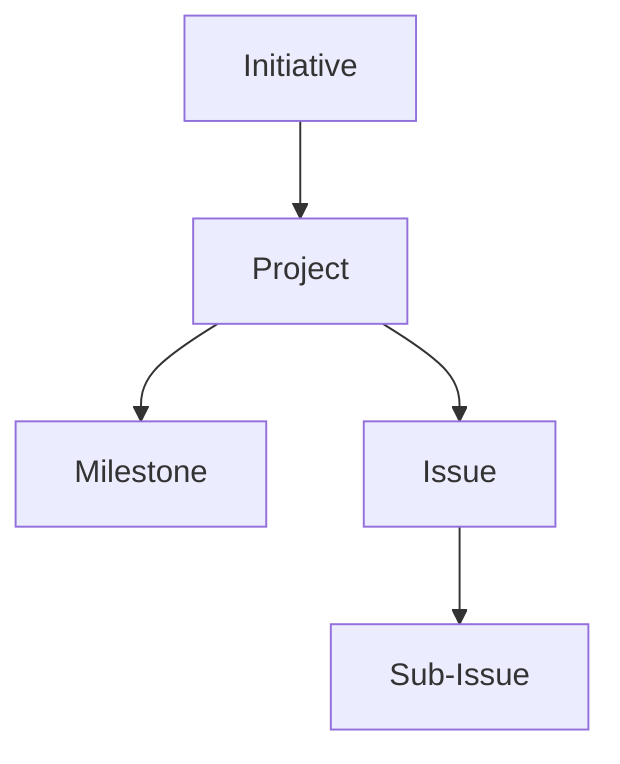

# Linear Hierarchy & Organization

This document outlines how we structure work in Linear to balance clarity for a solo developer while remaining scalable for a small team.

## Core Hierarchy

We follow standard Linear hierarchy with specific conventions for our "Solo Dev + Scalable" approach.

### 1. Initiatives (Goals)
**Purpose:** Group related Projects together representing larger company goals or workstreams (e.g., "Q1 Launch", "Platform V1").
*   Initiatives are the highest level of organization.
*   Use them to declutter the Projects view.

### 2. Projects (Deliverables)
We align Linear Projects with our **"Upstream Waterfall"** architecture and business units.

*   **🔴 Core Platform:** Work related to `autana/gridbase`. UI components, performance, generic blocks.
*   **🟡 ResearchNet:** Work related to `autana/researchnet`. Schema design, OpenAlex sync, grant compliance.
*   **Projects** define **"The Deliverable"** (e.g., Core Platform vs ResearchNet).
*   **🔵 Client: DIAL:** Work specific to `clients/dial-web`. Content, deployment, DIAL-specific requests, **DIAL Handbook**.
*   **🟣 Internal: Automation:** Work related to `autana/gridforge`. Scaffolding scripts, MCP agents.
*   **🟢 Open Source Stack:** Work related to the low-cost infrastructure (Plane, Frappe HR, **Generic Handbook Template**).
*   **⚪ Autana Operations:** Work related to running Autana Systems (business development, marketing, legal, generic n8n flows).

*Projects define "What we are delivering".*

### 3. Issues (Tasks)
**Purpose:** Individual units of work.
*   Issues must always belong to a Project if they are part of a larger goal.
*   Standalone bugs or chores can exist without a project.

## Organization Strategy

### The "Where" vs. "What"
*   **Projects** define **"The Deliverable"** (e.g., Core Platform vs ResearchNet).
*   **Labels** define **"The Code Area"** (e.g., Frontend vs Admin).

### Views
We use saved Views to slice the data for different contexts:
1.  **Kanban by Project:** Filter by specific Project to see progress toward that deliverable.
2.  **Work by Team Member:** Filter by Assignee to see individual workloads.
3.  **Area Specific:** Filter by Label (e.g., `Label: Frontend`) to see all frontend work across multiple projects.